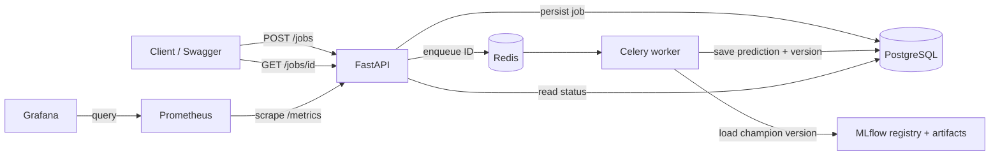

# Mini MLOps: one model, one job queue, a complete deployment

An interview demo for Windows + Ubuntu WSL2. Predict an Iris flower from four measurements, using a tiny scikit-learn model. No dataset downloads, GPU, cloud account, or paid services required.

**Start with Docker Compose, then run the same application on Kubernetes with Terraform.** All nine requested technology groups do real work. The Python application is only five small modules.

New to these tools? Read the [beginner's guide](docs/BEGINNER-GUIDE.md) first. The Python functions, Compose settings, CI workflow, Dockerfile, and deployment script include explanations beside the code.

**Already set up on your laptop?** Follow [Start again after a reboot](docs/LOCAL-DEMO.md#start-again-after-a-reboot). That guide includes the prepared laptop's paths, start/stop commands, and demo URLs; the helper scripts are included in this repository.



| Component | Its concrete job | Main file |
|---|---|---|
| FastAPI + Pydantic | Validate four measurements; return 202 and a job ID; poll results | `app/main.py` |
| PostgreSQL | Persist inputs, status, result, and model version | `app/db.py` |
| Redis + Celery | Queue job IDs; run inference outside the API process | `app/tasks.py` |
| MLflow | Log training parameters/accuracy; store model; register versions and `champion` alias | `app/train.py` |
| Docker | One Python image reused for API, worker, training, and MLflow | `Dockerfile`, `compose.yaml` |
| Kubernetes | Deploy services, restart pods, scale workers, persist data with PVCs | Terraform resources |
| Terraform | Provision namespace, Deployments, Services, ConfigMaps, and PVCs in local kind | `terraform/main.tf` |
| GitHub Actions | Test; validate Terraform; build; deploy to temporary kind; smoke test | `.github/workflows/ci.yml` |
| Prometheus + Grafana | API availability, request rate, latency, job status dashboard | `monitoring/` |

## 1. Install Windows prerequisites

Open PowerShell. If WSL is already installed, skip its installation.

```powershell
wsl --install -d Ubuntu
winget install --exact --id Docker.DockerDesktop --accept-package-agreements --accept-source-agreements
```

Restart Windows if requested. Launch Docker Desktop, complete its first-run setup, and select Linux containers / WSL2 backend. In **Settings → Resources → WSL Integration**, enable your Ubuntu distribution and apply the change. Docker Desktop must stay running. Leave Docker Desktop's built-in Kubernetes disabled; this demo uses kind instead.

Allow approximately 6 GB available memory for Docker/WSL when running Kubernetes, plus several GB of disk for images. A 16 GB laptop is a comfortable starting point; exact usage varies. Run Compose and Kubernetes one at a time to conserve memory.

**Everything below runs in an Ubuntu WSL terminal, not PowerShell**, unless a block explicitly says PowerShell. No Windows installations of Python, PostgreSQL, Redis, Terraform, or Kubernetes are required.

```bash
docker version
docker compose version
docker run --rm hello-world
```

Expected: Docker client/server information and the hello-world success message. If `docker` is missing in Ubuntu, enable WSL integration and reopen Ubuntu. Do not install a second Docker daemon inside WSL.

## 2. Get the project and install WSL tools

If cloning from GitHub:

The repository is private. Your WSL Git client needs GitHub authentication for cloning; a GitHub account password is not accepted as a Git password. If Git is already authenticated in Windows, clone there with PowerShell, then open that directory through `/mnt/c/...` in WSL. You can also download the supplied project ZIP and skip cloning entirely.

```bash
sudo apt-get update
sudo apt-get install -y git
git clone https://github.com/jimwangllm-agentic/mini-mlops.git
cd mini-mlops
```

If using the downloaded ZIP, extract it and open its `mini-mlops` folder in WSL instead. Prefer keeping the working copy in WSL's Linux filesystem for faster builds, for example `~/projects/mini-mlops`. The commands work from a Windows-mounted directory as well.

Install kind, kubectl, Terraform, Git, and Python 3 inside WSL:

```bash
bash scripts/install-tools.sh
```

The script downloads specific demo versions from the official kind, Kubernetes, and HashiCorp distributions. It supports x86-64 and ARM64 Ubuntu. It may ask for your Ubuntu sudo password. Application Python 3.12 and its libraries are installed by the Docker image, independently of your WSL Python version.

## 3. Start with Docker Compose

From the repository root:

```bash
docker compose up --build -d
docker compose ps -a
docker compose logs train
```

The first build downloads Python libraries and can take several minutes. Training exits with code 0 after registering `iris` version 1 and assigning `champion`. Other application containers keep running. Subsequent fresh training runs create additional versions.

Run the end-to-end check:

```bash
python3 scripts/smoke.py
```

Expected: a JSON result with `status: succeeded`, `class_name: setosa`, a `model_version`, and a final `PASS` message. This checks the real API, PostgreSQL, Redis, Celery, model download from MLflow, and metrics endpoint.

## 4. Submit and poll a prediction

Open [Swagger UI](http://localhost:8000/docs). Expand **POST /jobs**, choose **Try it out**, and send:

```json
{"features": [5.1, 3.5, 1.4, 0.2]}
```

Order, in centimeters: **sepal length, sepal width, petal length, petal width**. The response is HTTP 202 with an `id`. Copy the ID into **GET /jobs/{job_id}** and execute. It changes from `queued` to `running` to `succeeded` (small jobs may finish too quickly to see intermediate states).

Expected final response:

```json
{
  "id": "<your-job-uuid>",
  "status": "succeeded",
  "result": {"class_id": 0, "class_name": "setosa", "model_version": "1"},
  "error": null
}
```

Send `{"features": [1, 2]}` to demonstrate HTTP 422 validation.

Alternatively, in **PowerShell** while Compose is running:

```powershell
$job = Invoke-RestMethod -Method Post -Uri http://localhost:8000/jobs -ContentType application/json -Body '{"features":[5.1,3.5,1.4,0.2]}'
Invoke-RestMethod "http://localhost:8000/jobs/$($job.id)" | ConvertTo-Json -Depth 5
```

## 5. Inspect each part

| What to show | Address / WSL command | Expected evidence |
|---|---|---|
| FastAPI | [Swagger UI](http://localhost:8000/docs) | 202 response, polling, 422 invalid input |
| Job records | `docker compose exec postgres psql -U demo -d demo -c 'SELECT id,status,result FROM prediction_jobs;'` | Stored result and model version |
| Worker | `docker compose logs worker --tail=30` | Received and completed task |
| Redis | `docker compose exec redis redis-cli PING` | PONG |
| MLflow | [MLflow](http://localhost:5000) | Experiment `iris-demo`; accuracy; Models → `iris` → version and alias |
| Prometheus | [Targets](http://localhost:9090/targets) | `api` target UP |
| Grafana | [Iris dashboard](http://localhost:3000/d/iris-demo) | Login `admin` / `admin`; job counts and request metrics |

Run the smoke script several times to generate traffic. Allow 10–15 seconds for scraping and about a minute for rate/latency charts. MLflow's test accuracy measures model quality; Prometheus's latency measures application performance. They answer different questions.

Show persistence: run `docker compose restart api worker`, then GET the same job ID again. PostgreSQL, Redis, and MLflow use named volumes. Prometheus history and Grafana session/config changes are intentionally ephemeral; the supplied dashboard is provisioned on startup.

Retrain/register another model version:

```bash
docker compose run --rm train
python3 scripts/smoke.py
```

The worker resolves `champion` for each job and caches models by version, so new requests pick up the new alias without a worker restart. This demo retrains the same deterministic model; it demonstrates version management, not a real accuracy improvement.

## 6. Run Kubernetes + Terraform

Stop Compose first to free memory and local ports. This preserves its volumes:

```bash
docker compose down
bash scripts/deploy.sh
```

The script creates a single-node kind cluster, builds/loads the image, runs Terraform, waits for deployments, then runs training as a Kubernetes Job. Terraform creates actual local Kubernetes resources; kind bootstraps the cluster itself. No cloud resources are provisioned. Kubernetes has its own fresh PostgreSQL and MLflow storage, separate from Compose.

Inspect:

```bash
kubectl --context kind-mini-mlops -n mini-mlops get pods,services,pvc,jobs
terraform -chdir=terraform plan
```

Start each port-forward in a **separate WSL terminal**, leaving it running:

```bash
kubectl --context kind-mini-mlops -n mini-mlops port-forward service/api 8000:8000
```

```bash
kubectl --context kind-mini-mlops -n mini-mlops port-forward service/mlflow 5000:5000
```

```bash
kubectl --context kind-mini-mlops -n mini-mlops port-forward service/prometheus 9090:9090
```

```bash
kubectl --context kind-mini-mlops -n mini-mlops port-forward service/grafana 3000:3000
```

Run `python3 scripts/smoke.py` from a fifth terminal. The same Swagger, MLflow, Prometheus, and Grafana URLs now point to Kubernetes through localhost forwarding.

Scale workers using Terraform:

```bash
terraform -chdir=terraform apply -var='worker_replicas=2'
kubectl --context kind-mini-mlops -n mini-mlops get pods -l app=worker
```

Expected: two worker pods, each with concurrency 1, sharing Redis and PostgreSQL. This is **manual horizontal scaling**; an HPA/KEDA autoscaler is deliberately omitted. To keep 2 replicas across later applies, set `worker_replicas = 2` in `terraform/local.tfvars` and use `-var-file=local.tfvars`, or export `TF_VAR_worker_replicas=2` in your shell.

Demonstrate self-healing by deleting a disposable worker pod:

```bash
kubectl --context kind-mini-mlops -n mini-mlops delete pod -l app=worker
kubectl --context kind-mini-mlops -n mini-mlops get pods -l app=worker
```

The Deployment creates replacements. Use `kubectl ... logs deployment/worker` to inspect work. For stateful services this demo uses one replica and Recreate deployments with PVCs; these are intentionally simple local resources rather than a high-availability database design.

## 7. GitHub Actions: tests and automated deployment

Open the repository's **Actions** tab after pushing to `main`. The workflow:

1. Runs API/worker/model tests against disposable PostgreSQL.
2. Checks Terraform formatting and schema validity.
3. Builds an image tagged with the Git commit SHA.
4. Creates temporary Kubernetes on the GitHub-hosted runner using kind.
5. Provisions with Terraform, trains/registers a model, and deploys all services.
6. Performs a real asynchronous prediction and deletes the temporary cluster.

Pull requests run the test job. Pushes to main and manual **Run workflow** runs also deploy. No cloud secrets are needed. **The automated deployment is on the runner, not your laptop.** GitHub-hosted runners cannot reach your local kind cluster. Run `bash scripts/deploy.sh` locally to deploy the same source yourself. For production you would add a registry, cloud identity via OIDC, and a persistent remote cluster.

## 8. Tests without a running stack

Use **Python 3.12** for these developer tests (the installed WSL Python can differ):

```bash
docker build -t mini-mlops:local .
docker run --rm -v "$PWD/tests:/code/tests:ro" mini-mlops:local python -m pytest -q
```

This test suite uses temporary SQLite, a real locally trained MLflow-registered model, and a mocked broker submission. It verifies input rejection, persistence-before-enqueue, predictions, completed-task redelivery, broker failure, worker failure, and metric labels. GitHub Actions uses real PostgreSQL for these same tests. `scripts/smoke.py` additionally tests the real Redis/Celery/network path against a running deployment.

## 9. Stop and clean up

Compose, retain application data:

```bash
docker compose down
```

Compose, **delete this demo's persisted jobs/models/queue**:

```bash
docker compose down -v
```

Kubernetes, **delete this demo's resources and data**:

```bash
terraform -chdir=terraform destroy
kind delete cluster --name mini-mlops
```

Destroy Terraform resources while the cluster still exists. Close port-forward terminals with Ctrl+C. Retain the ignored Terraform state until cleanup is complete; never commit it. If you delete the cluster first, remove the local Terraform state only when you intend to start again with an empty cluster.

## Troubleshooting

| Symptom | Check / fix |
|---|---|
| `docker: command not found` or cannot connect | Start Docker Desktop; enable Ubuntu WSL integration; reopen WSL |
| `train` exited with code 0 | Normal: one-off training succeeded |
| `train` failed / API not starting | `docker compose logs mlflow train`; check free RAM/disk; first build needs internet |
| A job stays queued | `docker compose logs worker`; confirm worker is running |
| Failed job with registry/model error | Confirm training succeeded and `iris` has a `champion` alias; retrain then submit a new job |
| Empty Grafana charts | Run smoke tests; check Prometheus Targets; wait one minute; login admin/admin |
| Port already in use | Stop Compose or the existing port-forward before starting the other deployment |
| kind pods `ImagePullBackOff` | `kind load docker-image mini-mlops:local --name mini-mlops`; confirm tag matches Terraform |
| API initially CrashLoopBackOff | PostgreSQL may still be starting; wait for rollout; check logs if it persists |
| PVC Pending | `kubectl --context kind-mini-mlops get storageclass`; kind's default provisioner must be ready |
| OOMKilled | Increase Docker/WSL memory; stop the other stack; inspect `kubectl describe pod` |
| Changes don't appear after rebuild | Prefer a new tag: `IMAGE=mini-mlops:v2 bash scripts/deploy.sh` |

## Scope and interview preparation

Read [the interview walkthrough](docs/INTERVIEW.md) and [the AWS/Azure/GCP comparison](docs/CLOUD-ALTERNATIVES.md).

This is a local teaching project with fixed demo credentials, loopback-only exposed Compose ports, no authentication/TLS, single-replica data services, and intentionally pinned demo versions. Review and update dependencies before any shared/public deployment. No public ingress is configured.

Known reliability boundary: committing a PostgreSQL row and publishing to Redis are two separate operations. A process crash between them can leave a queued row without a message. A network ambiguity can also mean a message was delivered despite a publish error. Production uses a transactional outbox plus idempotent consumers. Celery late acknowledgements permit redelivery, not exactly-once execution; duplicate computation is acceptable here. There is no automatic recovery for every stuck job or external dependency failure. Failed jobs are terminal; submit a new job after fixing the cause.

Official setup references: [Docker + WSL](https://docs.docker.com/desktop/features/wsl/), [kind quick start](https://kind.sigs.k8s.io/docs/user/quick-start/), [kubectl installation](https://kubernetes.io/docs/tasks/tools/install-kubectl-linux/), [Terraform installation](https://developer.hashicorp.com/terraform/install), [MLflow tracking](https://mlflow.org/docs/2.22.0/tracking/).
