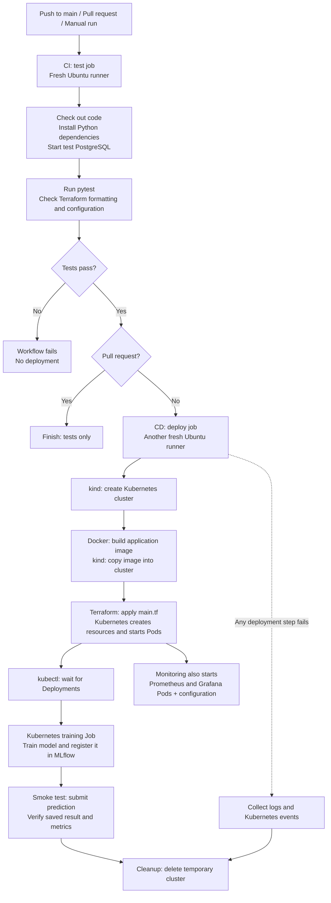

# How this project's CI/CD runs

CI means continuous integration: check the code and configuration. CD means
continuous delivery/deployment: build and deploy the application, then verify it.
This project's deployment is a temporary integration-test environment on GitHub's
runners. It does not publish a persistent production environment or update your laptop.

The workflow runs on **temporary GitHub machines**, separate from your laptop.
It builds and tests a fresh deployment, then deletes it.

## Entire pipeline



The failure arrow represents a failure anywhere in the deploy job. Diagnostics
run on failure; cleanup is attempted on success or failure. The test and deploy
jobs have separate runners, so each checks out the code and installs its own tools.

## 1. What starts the pipeline?

Read the [workflow triggers in ci.yml](../.github/workflows/ci.yml#L6-L10):

```yaml
on:
  push:
    branches: [main]
  pull_request:
  workflow_dispatch:
```

A push to `main`, a pull request, or the manual **Run workflow** button starts it.
There is no path filter, so documentation-only pushes to main also trigger it.
Open [GitHub Actions runs](https://github.com/jimwangllm-agentic/mini-mlops/actions)
to see the jobs and their logs.

## 2. CI checks the code and Terraform configuration

The [test job](../.github/workflows/ci.yml#L25-L67) starts a disposable PostgreSQL
service container, installs dependencies, then runs:

```bash
# Run application tests against the disposable test database.
python -m pytest -q

# Check formatting, download providers, and validate the infrastructure configuration.
terraform -chdir=terraform fmt -check
terraform -chdir=terraform init -backend=false
terraform -chdir=terraform validate
```

These steps test the application and validate Terraform. They do not deploy
Kubernetes resources. `-backend=false` skips Terraform state-backend setup for
this validation job. The test database is separate from your laptop's database.
Read [tests/test_app.py](../tests/test_app.py) for the application checks.

## 3. CD starts only after tests succeed

Read the [deploy job conditions](../.github/workflows/ci.yml#L69-L72):

```yaml
deploy:
  if: github.event_name != 'pull_request'
  needs: test
  runs-on: ubuntu-latest
```

`needs: test` requires successful tests. The `if` skips deployment for pull
requests. Main pushes and manual runs proceed to deployment after successful tests.

After installing Python, Terraform, kind, and kubectl, the workflow
[calls the deployment script](../.github/workflows/ci.yml#L88-L93):

```yaml
run: IMAGE=mini-mlops:${{ github.sha }} bash scripts/deploy.sh
```

`github.sha` is the commit ID, so the image tag identifies the source version
being tested. `IMAGE=...` passes the chosen tag to the script as an environment
variable. No image is published to a registry in this workflow.

## 4. Create the cluster, build the image, and apply Terraform

Read [scripts/deploy.sh](../scripts/deploy.sh#L7-L28). These are its key commands;
the cluster-creation command is inside an `if` that checks whether it already exists:

```bash
# Terraform reads this environment variable as its input variable named image.
export TF_VAR_image="$IMAGE"

# Create the cluster if it does not exist.
kind create cluster --name mini-mlops --image kindest/node:v1.32.2 --wait 120s

# Build the application image and copy it into the cluster's image storage.
docker build -t "$IMAGE" .
kind load docker-image "$IMAGE" --name mini-mlops

# Prepare Terraform and create/update the Kubernetes resources.
terraform -chdir=terraform init -input=false
terraform -chdir=terraform apply -auto-approve -input=false
```

The fresh deployment runner has no existing demo cluster, so kind creates one.
The `kindest/node` image contains the Kubernetes node; it is separate from the
application image built using our [Dockerfile](../Dockerfile).

Terraform reads [main.tf](../terraform/main.tf). The Kubernetes Deployment
resource includes these settings in its respective configuration blocks:

```hcl
replicas = each.value.replicas
```

```hcl
image = each.value.image
```

See the [replica setting](../terraform/main.tf#L251) and
[container image setting](../terraform/main.tf#L273).
Terraform sends the desired resource configuration to the Kubernetes API.
Kubernetes creates the Pods and starts their containers. Terraform configures
resources inside the cluster; the script's kind command creates the cluster itself.

`-input=false` disables interactive questions, and `-auto-approve` lets the
automated workflow apply without waiting for someone to type yes.
Docker Compose is not involved in this Kubernetes deployment path.

## 5. Wait for startup, then train the model

The [readiness loop](../scripts/deploy.sh#L29-L33) waits for all seven Deployments:

```bash
for service in postgres redis mlflow api worker prometheus grafana; do
  kubectl --context kind-mini-mlops -n mini-mlops rollout status deployment/"$service" --timeout=300s
done
```

The components can start simultaneously, but this loop checks them one at a time.
It waits up to five minutes per Deployment. It checks rollout readiness; it does
not create resources or prove an end-to-end prediction works.

Next, the [training commands](../scripts/deploy.sh#L35-L55) create a Kubernetes Job:

```bash
# Give this training Job a unique name.
job="train-$(date +%s)"

# Generate the Job YAML, add the MLflow address, then create it in Kubernetes.
kubectl --context kind-mini-mlops -n mini-mlops create job "$job" --image="$IMAGE" --dry-run=client -o yaml -- python -m app.train |
  kubectl set env --local -f - MLFLOW_TRACKING_URI=http://mlflow:5000 -o yaml |
  kubectl --context kind-mini-mlops -n mini-mlops create -f -
```

The training container runs `python -m app.train`. Read [app/train.py](../app/train.py)
to see how it trains the Iris model, records accuracy, registers the model version,
and assigns the `champion` alias in MLflow. The script waits for the Job to complete
successfully and prints its logs; training failure stops deployment.

This Kubernetes training Job is different from a prediction job stored in
PostgreSQL and from a GitHub Actions job such as `test` or `deploy`.

## 6. Test a real prediction, then clean up

Read the [workflow verification step](../.github/workflows/ci.yml#L94-L103):

```bash
# Make the cluster's API reachable on the GitHub runner's localhost:8000.
# The final & leaves forwarding running in the background.
kubectl --context kind-mini-mlops -n mini-mlops port-forward service/api 8000:8000 > /tmp/port-forward.log 2>&1 &

# Submit a prediction and check the complete asynchronous path.
python scripts/smoke.py
```

Read [scripts/smoke.py](../scripts/smoke.py) for the assertions. It submits valid
input, polls the job, verifies the predicted species/model version, checks invalid
input rejection, and checks API metrics. The prediction exercises this path:

```text
FastAPI -> PostgreSQL job -> Redis -> Celery prediction -> PostgreSQL result
                                       |
                                       +-> MLflow model
```

The worker loads the model from MLflow and saves the result in PostgreSQL. The
smoke test reads it through the API. It does not directly query the database.
The workflow checks API metrics, but does not separately verify every Grafana
dashboard or Prometheus scrape target.

If deployment fails, the [diagnostics step](../.github/workflows/ci.yml#L104-L113)
collects Pods, training Jobs, storage claims, API/worker logs, and Kubernetes events.

Finally, [cleanup](../.github/workflows/ci.yml#L114-L117) is attempted on success or failure:

```yaml
- name: Cleanup ephemeral cluster
  if: always()
  run: kind delete cluster --name mini-mlops
```

This deletes the temporary cluster on the GitHub runner, including that run's
database/model data. It does not delete or update your laptop's demo cluster.

## 7. How monitoring is deployed

Monitoring is deployed alongside the application, not as a separate GitHub
Actions job. The same `terraform apply` creates the Prometheus and Grafana
Deployments, Services, and ConfigMaps. The configuration files are mounted into
their containers, including the provisioned Grafana datasource and dashboard.
Read the [monitoring file definitions and mount paths](../terraform/main.tf#L165-L183)
and [ConfigMap resource](../terraform/main.tf#L187).

The [readiness loop](../scripts/deploy.sh#L29-L33) waits for both Deployments
along with the application components. The smoke test checks the API metrics
endpoint; it does not separately verify a Prometheus scrape or rendered Grafana
dashboard. Cleanup deletes the monitoring resources with the temporary cluster.

For how monitoring works, see the separate
[Monitoring section of the interview guide](INTERVIEW.md#6-monitoring--2-minutes).

## Interview wording

"Each main-branch push tests the code, builds an image, deploys it to temporary
Kubernetes using Terraform, trains a model, verifies a real asynchronous prediction,
and removes the test environment. Terraform also deploys Prometheus and Grafana
alongside the application. My laptop demo is managed separately."
